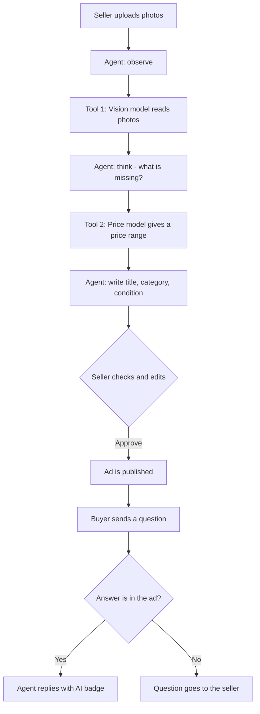

# Part C: Specialised Technology - Agentic AI

**Main technology:** Agentic AI.
**Supporting tool:** Computer vision, used by the agent to read photos.

## C1. Fundamental Concepts

### What is Agentic AI?

Agentic AI is a type of AI system that works toward a goal in several steps, not just one answer. A normal chatbot answers one question at a time. An AI agent can plan what to do next, use tools, look at the result, and then decide the next step. A person can still check or stop it.

### Key concepts

| Concept | Simple meaning | Example in this project |
| :--- | :--- | :--- |
| Goal | What the agent must achieve | "Help the seller publish a complete ad" |
| Perception | What the agent can see or read | Seller photos, ad text, buyer messages |
| Tools | Functions the agent can call | Photo reader, price lookup, send message |
| Reasoning and planning | Deciding which step is next | "I have the item type, now I need the price" |
| Memory | Facts the agent keeps during the task | The ad details written so far |
| Guardrails | Rules that limit the agent | Answer only from the ad. Show the AI badge. |
| Human in the loop | A person can check or change the result | The seller edits suggestions before publishing |

### How it works (basic level)

An agent runs in a loop: **observe, think, act, check, repeat**. A language model usually does the "think" step. It reads the situation, chooses a tool, and writes what to do next. One well-known method that mixes reasoning with actions is ReAct (Yao et al., 2023).

The computer vision part is one tool. Computer vision models learn patterns from many images so they can find and name objects in new images (Verdhan, 2021). Some models, such as CLIP, link images and text, so a photo can be matched to words like "laptop" or "wooden chair" (Radford et al., 2021).

### Figure 1: How the agent works in this project

### Worked example

A seller uploads 3 photos of a used laptop.

1. **Observe:** the agent receives 3 photos.
2. **Act (vision tool):** the tool finds "laptop", a silver colour, and a scratch on the lid.
3. **Think:** the agent decides it still needs a price.
4. **Act (price tool):** the tool returns a price range from similar ads.
5. **Output:** the agent suggests the title "Silver laptop, light scratch on lid", the category "Computers", the condition "Good" and a price range.
6. **Check:** the seller edits the title and publishes.
7. Later, a buyer asks "Does it have a scratch?". The agent finds "light scratch on lid" in the ad and replies with an AI badge.

## C2. Frameworks, Models, Methods and Tools

| Tool or method | What it is | What I use it for |
| :--- | :--- | :--- |
| **ReAct** (method) | A way to let a language model switch between thinking and using tools | The pattern for the agent loop (Yao et al., 2023) |
| **LangGraph** (framework) | A library to build agents as steps that pass data to each other | Control the agent flow, tool calls and the hand-over to the seller (LangChain, n.d.) |
| **CLIP** (model) | A model trained on images and text together | Match photos to item names and tags (Radford et al., 2021) |
| **YOLOv8** (model) | A fast object detection model | Find the item and visible damage in a photo (Ultralytics, n.d.) |
| **Gradient boosting with scikit-learn** (algorithm and library) | A method that builds many small decision trees to predict a number | Predict a fair price range from past ad data (Friedman, 2001; Pedregosa et al., 2011) |

## C3. Fit to the Problem

### How it helps

- **Seller side:** the agent reads the photos and fills in most of the form. The seller only checks and edits. This reduces manual typing and missing details.
- **Buyer side:** the agent answers simple questions from the ad when the seller is offline. This reduces waiting time.
- **Trust:** the AI badge and the seller's right to edit keep people in control.

### Benefits

- Fewer manual steps for the seller.
- Ads that are more complete and more consistent.
- Faster first reply for buyers.
- One agent can handle many ads at the same time.

I do not give exact time savings here. I would measure them in a pilot, using the targets in NFR1 and NFR2.

### Limitations and risks

1. **Wrong answers.** The vision model can misread a photo, and the language model can make up facts (hallucinate). A wrong condition label or price can cause trust problems. Guardrails and seller approval reduce this risk.
2. **Data needs.** Good price and defect models need many correct, labelled examples. Mudah.my would need to supply this data.
3. **Privacy.** Photos may show faces, house numbers or number plates. They must be sent safely and deleted (NFR4).
4. **Bias and coverage.** The models may work worse on some items, such as local products or unusual items, if the training data did not include them.
5. **Cost and delay.** Running vision and language models costs money and takes time on every ad (NFR1).

### Alternative: a rule-based form wizard

A rule-based wizard asks fixed questions step by step and uses fixed rules, with no AI.

| | Rule-based wizard | Agentic AI |
| :--- | :--- | :--- |
| Cost | Low | Higher |
| Predictability | High, the same input gives the same output | Lower, the output can change |
| Seller effort | The seller still types most details | The seller mostly checks and edits |
| Buyer replies | Does not help | Can answer simple questions |
| Risk of wrong output | Low | Medium |

**My choice:** I would choose Agentic AI, because it is the only option that reduces both the seller's typing and the buyer's waiting time. To control the risks, I would keep the seller in control and have the agent answer only from the ad. If the cost or the errors turned out too high, the rule-based wizard is a safe fallback (NFR5).

## References

References are listed in [research-sources.md](research-sources.md).
